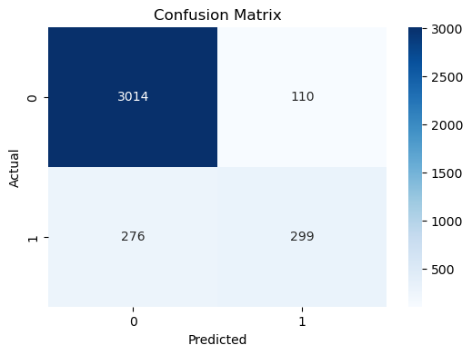
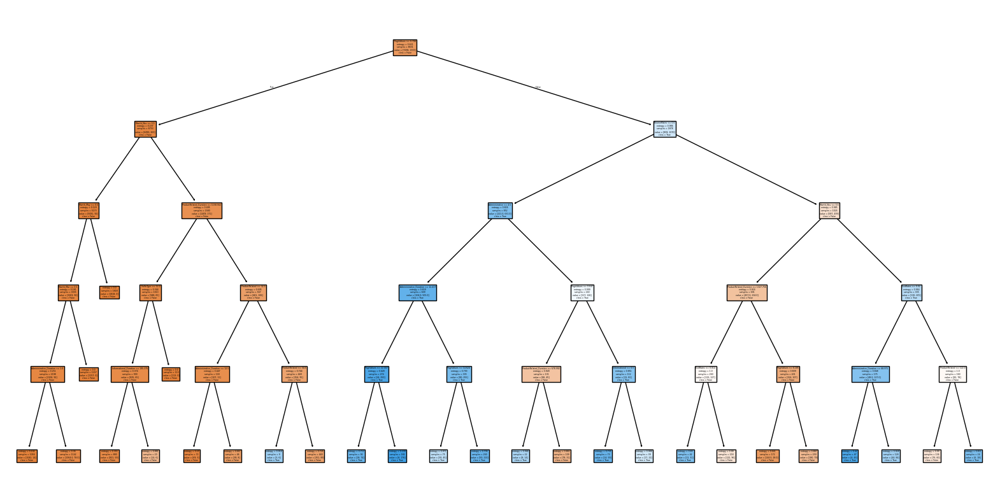

# Task 03 - Decision Tree Classifier

## Overview
In this task, we build a **Decision Tree Classifier** to predict whether a customer will purchase a product or service based on demographic and behavioral data.  
The dataset used can be the **Bank Marketing dataset (UCI)** or an alternative dataset with similar features.

## Steps
1. Import libraries (pandas, numpy, matplotlib, seaborn, scikit-learn).
2. Load and preprocess dataset (handle missing values, encode categorical features).
3. Split data into training and testing sets.
4. Train a Decision Tree Classifier.
5. Evaluate model performance (accuracy, confusion matrix, classification report).
6. Visualize the decision tree.

## Visuals
All generated plots are saved in the `visuals/` folder:

Confusion Matrix:

Decision Tree:

## Results
- Accuracy score of the classifier
- Insights from confusion matrix and classification report
- Tree visualization for interpretability

